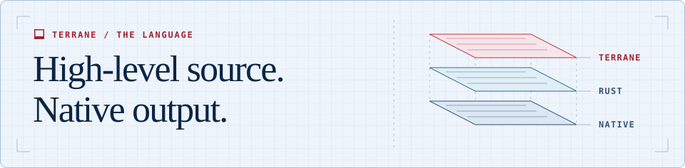

# Terrane



Terrane is an experimental programming language for writing native software. You write indentation-sensitive source with static types, value semantics, and explicit contracts. Terrane emits readable Rust, then Cargo and rustc build a native executable. There’s no interpreter or VM, and you can inspect the code that actually gets compiled.

[Quick start](#quick-start) · [The Terrane Book](https://github.com/streaky/terrane-manual/tree/main/tutorial-book) · [Reference](https://github.com/streaky/terrane-manual/tree/main/reference) · [Language scoreboard](https://streaky.github.io/terrane/published/scoreboards/language.html)

> **Experimental · Linux only · Build from source.** The language, CLI, and generated-code contracts are still evolving. There’s no finalized release distribution; Windows and macOS aren’t supported.

## Quick start

On Linux, install [Rust through rustup](https://rustup.rs/) and a native linker. From the repository root, install the compiler; the checkout selects the [Rust toolchain](rust-toolchain.toml).

```sh
cargo install --locked --path crates/terrane-cli
terrane toolchain install
terrane --version
```

The installer asks rustup for the stable build tools and the nightly Rustdoc tools (including `rust-src`) pinned by this Terrane binary. It skips requirements already installed. In CI or an offline environment, use `terrane toolchain check` to verify the image without downloading anything.

For a package with locked Rust dependencies, run `terrane fetch <package>` while connected to prepare Cargo's cache for the package and its build-time consumers. This is separate from installing the toolchain.

Save this as `total.trn`:

```terrane
namespace example

from /core/collections import list

function sum int; values list of int
  total = 0
  for value in values
    total = total + value
  return total

function main;
  values = list; 10, 12, 20
  total = sum; values
  print; "Total: {total}"
```

```console
$ terrane run total.trn
Total: 42
```

`terrane check total.trn` validates the program, `terrane build total.trn` prints the path to its native executable, and `terrane rust -o total.rs total.trn` writes the Rust for inspection, with a support sidecar when needed. Add `--release` to `build` or `run` to optimize the program.

<details>
<summary>Turn this into a multi-file package</summary>

Put the same source in `example/src/main.trn` and save this as `example/package.toml`:

```toml
package = "example"

[namespaces]
example = "src"
```

Run `terrane run example` from the parent directory. Commands accept a package directory, manifest, or standalone source file. Ignore generated `**/.trn/` directories in Git; if the package uses Rust dependencies, commit `terrane-dependencies.lock`. See the [package manifest reference](https://github.com/streaky/terrane-manual/blob/main/reference/records/packages/package-manifest.yaml) for configuration and the [CLI reference](https://github.com/streaky/terrane-manual/blob/main/reference/records/packages/command-line.yaml) for standalone scripts and other workflows.

</details>

## What makes it Terrane?

**Objects without a mandatory heap model.** Everything is an object in Terrane’s semantics, but a value needn’t become a heap object. Integers can use machine scalars, calls can lower directly to Rust, and independent values can share copy-on-write storage until mutation. The compiler chooses the representation without changing what the source means.

**Rust libraries through Terrane contracts.** Declare an exact crate version, its features, and required effects in `package.toml`, then import the supported API from `/deps/<alias>/…`. This is called *projection*: the compiler exposes Terrane declarations while retaining the native types and checking supported ownership, borrowing, and error crossings. It reports unsupported calls instead of silently substituting an adapter. See the [Rust dependency guide](https://github.com/streaky/terrane-manual/blob/main/reference/records/packages/rust-dependencies.yaml) for the workflow, Linux sandbox requirements, and explicit native escape hatches.

**Native tools that work in source terms.** `terrane test` runs unit, integration, and end-to-end tests in isolated native processes. The [VS Code extension](editors/vscode/) provides compiler-backed editing; the [LLDB-backed debugger](https://github.com/streaky/terrane-manual/blob/main/reference/records/tooling/debugging.yaml) maps frames and locals back to Terrane. The [profiler](https://github.com/streaky/terrane-manual/blob/main/reference/records/tooling/profiling.yaml) captures CPU samples, allocations, and process-memory timelines, with source attribution where the capture provides it.

## What you can use today

| Area | Implemented |
| --- | --- |
| Types and behavior | Classes, interfaces, traits, generics, closures, payload enums with exhaustive matching, optional and union types, reflection |
| Values and ownership | Exact adaptive integers, Unicode strings, typed collections, copy-on-write values, references, explicit moves, deterministic destruction |
| Errors and concurrency | Typed throwable errors and `throws` contracts, async functions, structured task scopes, cancellation, deadlines, channels, async selection |
| Standard library | Capability-gated filesystem and process operations, streams, JSON and safe YAML, codecs, TLS, networking, structured logging |
| Packages and tooling | Terrane libraries, projected Rust dependencies, authored Rust modules and C ABI boundaries, build-time source generation, formatting, native testing, debugging, profiling |

The [language scoreboard](https://streaky.github.io/terrane/published/scoreboards/language.html) links features to their implementation evidence. The [current limitations](https://github.com/streaky/terrane-manual/blob/main/reference/records/tooling/current-limitations.yaml) cover known gaps and workarounds. The [roadmap](docs/compiler-plan.md#7-active-milestone-roadmap) tracks broader Rust API coverage, release hardening, and offline projection distribution.

## Where next?

- **Contribute:** See [Developing Terrane](docs/developing.md) for building the compiler, running focused tests, refreshing scoreboards, and collecting coverage.

## License

Terrane is dual-licensed under the [Apache License 2.0](LICENSE-APACHE) and the [MIT license](LICENSE-MIT), at your option.
